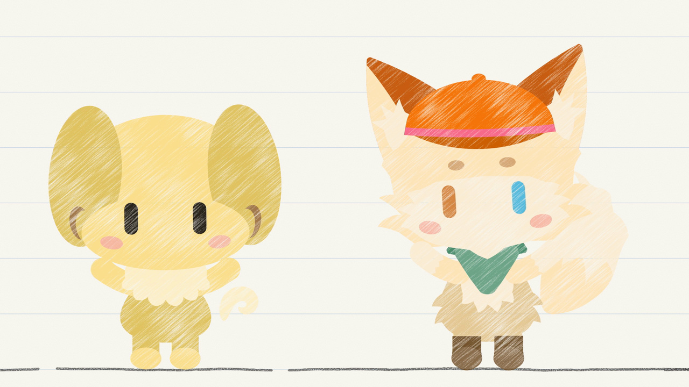

# phy's fwiends

phy's personal style, and the fwiends drawn in it. The repository is in two
parts. The **library**, `lib/`, is what other work uses: a tiny factory for
characters in coloured pencil (`lib/fwiends/`), phy's style as a CSS kit and
as styles for figures (`lib/style/`), and phy's dotfiles in the same inks
(`lib/dotfiles/`). The **demos** use it: the site's pages at the root, the
films in `demo/` and the page mockups in `design/`. The repository and the
code are named `phy_friends`.

[](https://rareone0602.github.io/phy_friends/demo/say-hi/)

*say hi*, a music video about the library, drawn by the library itself (`demo/say-hi/`).

## Layout

The repository is laid out by what each part is for:

```
lib/                      the library: what other work uses
  fwiends/src/            what a friend is and does
  fwiends/film/           the film kit: friends together on a sheet, played in a page or filmed
  fwiends/characters/     the fwiends: a spec each, and the cast
  fwiends/props/          the things the films share: a spec each
  style/site/             the kit, phy's CSS library: the stylesheets, the face, the graphite filter and the icons
  style/figures/          the house style for charts and diagrams
  dotfiles/               phy's setup on every machine: the vimrc, and Claude Code's settings and status line
index.html  style.html  preview.png
                          the site (GitHub Pages serves it from the root), and its link preview
demo/                     one-off pieces, each in a folder of its own
design/                   page mockups, and the candidates not taken
tools/                    the command line, the checks, and the scripts that derive what is derived
test/                     the in-browser tests
out/                      generated output (git-ignored)
```

Dependencies run one way. The demos use the library and the library never uses
them; phy's style and dotfiles use nothing of the fwiends, so that each can be
taken up alone. Pages elsewhere link the library where GitHub Pages publishes
it rather than copy it, so that nothing is kept twice; for the same reason,
everything one file derives from another is written by a tool, never by hand.
`python3 tools/pf.py test` checks that every link resolves, that dependencies
run one way, that everything derived is up to date, and that the kit keeps
every name a page linking it may use.

| path | what |
|---|---|
| `index.html`, `style.html`, `preview.png` | the site: the gallery, with its link preview; and the style guide, `STYLE.md` and `FWIENDS.md` drawn by hand, with the kit at work and its dial (`--informal`) to turn |
| `lib/style/site/` | the kit, phy's CSS library (its README lists the tokens, type, marks and classes): `phy.css` loads `notebook.css`, the paper (and the dark sheet), and `pencil.css`, everything drawn on it; `papers.css`, loaded after them, gives a piece other sheets (graph paper, a score, kraft, tracing paper and more); `graphite.js` writes the graphite filter into a page; `fonts/` holds the face (a Latin subset of Shantell Sans, served from the site, not by a font service); and the icons are phy's head |
| `lib/style/figures/` | the house style for charts, slides and a paper's diagram (its README lists the data colours and the rules): matplotlib styles; `phy-diagram.sty`, for a paper's TikZ diagram (`diagram.tex` is an example); and `fonts/`, the house face, Shantell Sans, with its licence |
| `lib/style/CASEBOOK.md` | phy's finished pieces, one line each: what it is, its look in one sentence and a link, so that the next piece can do something else |
| `lib/fwiends/` | the fwiends' library: the factory that draws a friend from its spec, animation, feelings, friends alive on a page, the film kit, the props and the characters; its README is the reference |
| `lib/dotfiles/` | phy's setup, one set of files for every machine (its README says how to set one up): `vimrc` (Google's indents and line lengths, in the house inks); Claude Code's recommended settings and its status line (`claude/`); and `install.sh`, which links the vimrc and the status line from a clone of their own, so that a `git pull` updates them |
| `demo/` | one-off pieces, each in its own folder: `index.html` lists the films (`roll-call/`, `card/`, `say-hi/`), which are made with the film kit |
| `design/` | page mockups: `index.html` lists them (C, the notebook, became the real page; A and B are kept as backups in `design/backup/`) |
| `tools/pf.py` | CLI: render stills, compare with a reference, export animations, film pages (with sound) and run the tests (headless Chrome + ffmpeg) |
| `tools/layout.py` | where each part of the repository lives, and the checks that every link resolves and that dependencies run one way |
| `tools/kit_api.py` | the kit's promise to the pages that link it: the check that it keeps every name the published kit defines |
| `tools/cdp.py` | a small client for the Chrome DevTools Protocol, with which `pf.py` drives headless Chrome for its drawings, films and tests |
| `tools/site_assets.py` | rebuilds the site's icons and link preview (the title over every friend, in rows at one size) after a character changes |
| `tools/title_pen.py` | derives the strokes that write the gallery's title (`lib/fwiends/src/title-pen.js`) |
| `tools/font_subset.py` | subsets the house face, `lib/style/figures/fonts/`, to the WOFF2 in `lib/style/site/fonts/` and copies its licence beside it (needs fontTools and brotli) |
| `tools/dark_sheet.py` | derives the dark sheet's inks, marks and data colours, and every other sheet's inks and marks, from the paper's (`lib/style/site/README.md`, `lib/style/figures/README.md`) and writes them into the kit, the figures' README and the dotfiles |
| `tools/palette.py`, `tools/colormath.py` | derive the data colours from the fwiends' own and test them (needs numpy) |
| `tools/shoot.py` | takes a screenshot of a page, such as a mockup, through a real `file://` address |
| `tools/animate.html` | a page for trying clips and feelings on every friend, live, seated or standing |
| `tools/feelings.html` | a review sheet of every friend in every feeling, with each feeling's mark, still or playing, seated or standing (`?stand`), or held at a moment of the feeling (`?at=1.5`) |
| `tools/props.html` | a review sheet of every prop in each of its states, standing on the rules beside phy at the gallery's size (`?rules=10` for twice that), and the party hat in Yuda's cyan |
| `tools/tune.html`, `tools/lorem.js` | the tuning page: sliders for the body plan that every friend shares (the core's `STAND_FIT`, `STAND_DEFAULT`, `ONIGIRI`, `BODY` and `TURN`), with every friend that stands, seated, standing and moving, then side-on, from behind and turning round, and the values to paste back into the code. It opens on the values in the code. `lorem.js` is the plain placeholder friend it shows first, which is not in the cast. `pf.py tune` writes it out as one file, `out/tune.html`, to send to an artist |
| `test/` | in-browser tests: `index.html` loads the library, `harness.js` and every `*.test.js`; `film-stub.html` is the smallest page `pf.py film` can film |
| `STYLE.md` | phy's style guide, a short programme for everything phy makes (the fixed rules, the words, the kit, pieces and how to work with phy), written to be handed to anyone, or any agent, making something for phy |
| `FWIENDS.md` | what only this project adds to it: the gallery page, the rules for drawing a friend, and the rules for scenes |
| `out/` | generated output, git-ignored: `out/<name>/` per character (stills, `compare/`, `anim/`), `out/design/` for page mockups, `out/props/` for the props' sheet, `out/tune.html` for the tuning page to send, `out/scratch/` for experiments |
| `LICENSE` | the GNU Affero General Public License, version 3, which covers everything here but the fwiends and the font (see [Licence](#licence)) |

New work goes where it will be used from:
- **What every friend can do goes in `lib/fwiends/src/`**: a new module is a
  classic script that adds to `PhyFriends`, loads after
  `lib/fwiends/src/anim.js`, and has its tests in `test/`. It works from the
  parts that every friend drawn to the house template has (the eyes, ears,
  blush, mouth, body and tail), so it suits all of them. Claude keeps every
  rule but the shape (FWIENDS.md, "Claude, the exception"), so a module may
  leave it out.
- **What every film needs goes in `lib/fwiends/film/`**, and `pf.py film` is
  how a film is recorded. A film's own script, props and soundtrack stay in
  its folder under `demo/`.
- **A prop that more than one film can use goes in `lib/fwiends/props/`**, one
  spec to a file (FWIENDS.md, "Props and sets"), and `tools/props.html` shows
  it beside phy. A prop only one film needs stays in that film's folder.
- **What makes anything phy's goes in `lib/style/`**: a token, a mark or a
  class in the kit (its README lists them), a rule for charts in `figures/`.
  The kit may add and restyle, but keeps every name a page may use.
- **phy's own setup goes in `lib/dotfiles/`**, one file for every machine,
  in the kit's inks, which `tools/dark_sheet.py` writes into it.
- **Working output goes in `out/`**, which git ignores; a built file is
  committed only where publishing needs it. A candidate that loses goes in a
  `backup/` folder beside the one that won, until phy says otherwise.
- **A one-off goes in `demo/`**, in a folder of its own. It may use anything in
  the library or the film kit, but nothing outside `demo/` may use it, so any
  one-off can be deleted without breaking the rest.

## CLI

```sh
python3 tools/pf.py list                                    # Characters and their examples
python3 tools/pf.py render howdi --size 512                 # out/howdi/portrait.png
python3 tools/pf.py render howdi --pose '{"eyes":"happy","mouth":"w"}' -o out/howdi/happy.png
python3 tools/pf.py render howdi --flat                     # The flat shapes, without the pencil
python3 tools/pf.py compare howdi                           # Every example: out/howdi/compare/ref.png + ref-diff.png
python3 tools/pf.py compare howdi --view ref --region 0,600,700,1254   # One example, metrics and a zoomed crop for a box
python3 tools/pf.py anim howdi --clip idle                  # out/howdi/anim/idle.gif
python3 tools/pf.py anim howdi --view stand --clip "layer(still({stance:'stand'}), wave)"  # Made for howdi: the wave is away from its tail
python3 tools/pf.py render howdi --with out/scratch/mine.js # Here mine.js redefines howdi, to try a working copy
python3 tools/pf.py film test/film-stub.html -o out/scratch/film/stub.mp4 --sheet   # A page, frame by frame
python3 tools/pf.py film test/film-stub.html --at 1 -o out/scratch/film/still.png  # One still from it
python3 tools/pf.py film test/film-stub.html --audio out/scratch/music.mp3 --from 0.5 --to 1.5 -o out/scratch/film/part.mp4  # A part, with its part of the sound
python3 tools/pf.py film test/film-stub.html --scale 2 --crf 12 -o out/scratch/film/master.mp4  # Twice the pixels each way, at a higher quality
python3 tools/pf.py test                                    # The in-browser tests, the pages against the cast, the derived files, and every page
python3 tools/pf.py pages                                   # The friends' script tags and the gallery's rows and slots, written from the cast
python3 tools/pf.py tune                                    # out/tune.html: the tuning page as one file, to send
```

`compare` snaps every pixel of the reference and the render to the nearest
palette colour and paints the disagreements red in `compare/<example>-diff.png`; it prints
the mismatch on a 4×4 grid and the per-colour overlap (IoU), which is a far
better guide than the mean pixel error.

`render`, `compare` and `anim` draw in a page that loads the library, the
characters and any `--with` script. They refuse a friend or a view that does not
exist, and a page that reports an error (a script that fails to load, a drawing
that throws) stops them with the page's message, so a broken working copy is
never drawn as the committed friend.

`film` films any page that keeps the film contract (the docstring of `film` in
`tools/pf.py`): opened with `?film`, the page fills the window (say hi keeps its
own 1920×1080 frame, so film it at another size with `--scale`, never `--size`,
which crops it), and `pf.py` seeks it to each frame's time in turn and takes a
screenshot. The video is therefore frame-exact however slow the machine, and
filming a page twice gives the same frames, byte for byte. A film with a friend
whose owner has not agreed to video is refused unless `--draft` is given, in
which case the page marks it as a draft.

With `--audio`, `film` puts a sound file under an `.mp4` or `.webm` film. The
frames are copied rather than encoded again, so they are the same with sound as
without, and the sound is cut to the filmed span by counting samples, so a part
filmed alone with `--from` and `--to` keeps in step with the whole film to the
sample. A sound that ends before the film is padded with silence, and `film`
says so; one that runs on is cut. It fades out only when `--fade` gives the
seconds to fade over, so a film cut to a looping track can loop too. The sound
is AAC at 320 kb/s in an `.mp4` and Opus at 192 kb/s in a `.webm`.

An `.mp4` or `.webm` is converted from the frames with the BT.709 matrix, in
limited range, and tagged as such (primaries, transfer and matrix), because that
is how browsers and YouTube decode HD video that says nothing about its colour;
ffmpeg's own default, BT.601 and untagged, shifts every saturated colour a
little (phy's green iris by about 4 ΔE). An `.mp4` must have an even width and
height, so a frame that is odd either way gains a column or a row that repeats
its edge. `--crf` sets the quality: 18 for an
`.mp4` and 30 for a `.webm` unless given, lower being better and larger, with
about 6 lower doubling the bit rate, which `film` prints. `--scale` films at
more pixels than the page's own size: a 1920×1080 film with `--scale
1.3333333333` comes out at 2560×1440, an upload that YouTube serves with its
better codec at every size, so that the pencil's grain survives on a phone.
YouTube asks for at least 8 Mb/s at 1080p30 and 16 Mb/s at 1440p30; coloured
pencil at 1440p needs about `--crf 12` to get there.

`test` runs `test/index.html` in headless Chrome, prints each failure, and exits
non-zero on a failure or a page error. The page also works opened by hand.
`test` also checks the gallery against the cast, which `index.html` repeats by
hand: each friend's name, species and credit, the name in its `aria-label`, the
host, the owner's agreement to the gallery, the footer's credit to Terry's owner
(any link marked `data-credit`), and the names in the link preview's alt text.
A mismatch is a failure that names the friend and the field. What
follows from the cast and the drawings is written, not typed: `pf.py pages`
(`tools/gallery.py`) writes the script tags of every page that loads all the
friends, in the cast's order, and the gallery's rows and slots, from the
friends' reaches; `test` fails while either is stale, and `pages` writes no
rows from a gallery that reports an error. `test` fails, too, while the dark
sheet's blocks (`tools/dark_sheet.py`) are stale, while an ink's contrast or a
data colour that the kit's README or `style.html` gives is not the kit's, while
a page's theme colour is not the paper's (or the dark sheet's), while a page
that draws in pencil pastes a graphite filter of its own or does not load
`lib/style/site/graphite.js`, and while `test/index.html` leaves out a
`*.test.js`. It fails while a local link names no file of the repository (one
into `out/` excepted, which a page looks for only with a fallback), while the
library links anything outside it or phy's style anything of the fwiends
(`tools/layout.py`), and while the kit drops a name that the published kit,
on `origin/main`, defines (`tools/kit_api.py`). Finally it opens the site's
pages, every tool page and every demo that `demo/index.html` lists, from disk
as a reader's browser does (unable to read the files beside a page) and with
requests to other hosts refused, so that a page that breaks shows up. Each page error names its page,
and the gallery's its window's width. A test that hangs in an endless loop is
stopped once the run has taken two minutes, and fails by name.

The CLI needs Google Chrome (override the path with `$CHROME`) and Pillow;
`compare` also needs numpy, video ffmpeg, and a film's sound the ffprobe that
comes with it.

## Licence

Copyright © 2026 phy.

Everything here, bar the two exceptions below, is under the GNU Affero General
Public License, version 3 only (`LICENSE`; SPDX `AGPL-3.0-only`), the strictest
of the GNU licences. Anyone who passes on a copy, changed or not, must pass on
its source under the same terms, and anyone who runs a changed copy that people
use over a network (a website, say) must offer those people its source too.
"Version 3 only" means that no later version of the licence applies.

The exceptions:
- **The fwiends.** Each character (its look, its name, everything in its
  folder under `lib/fwiends/characters/` and every picture of it, such as the
  site's icons and link preview) belongs to whoever is named under it in the
  gallery, and the licence gives no rights to it. That goes for phy's own, and
  for Claude's, whose figure is Claude Code's mascot and belongs to Anthropic.
- **Shantell Sans** (`lib/style/figures/fonts/`, and its subset in
  `lib/style/site/fonts/`) is under the SIL Open Font License, whose text sits
  next to each copy.
